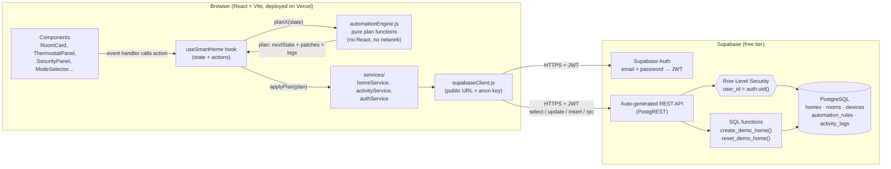
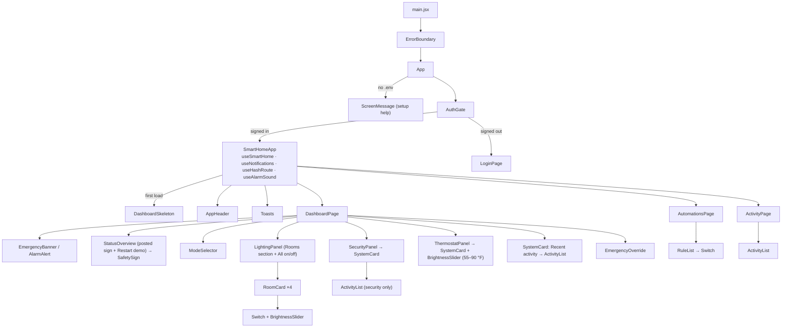
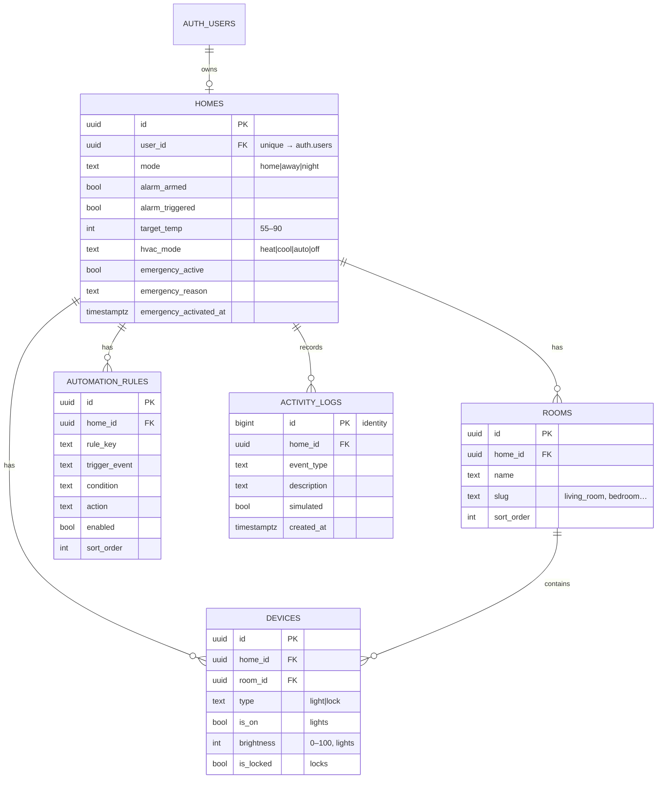

# Architecture: Smart Home Gone Rogue 2.0

## 1. The big picture



There is no custom backend server. The "backend" is Supabase: PostgreSQL, an auto-generated REST API, authentication and the security rules in the database. That's a deliberate decision (see §7).

## 2. Folder structure

```
src/
  main.jsx                 entry point; wraps App in an ErrorBoundary
  App.jsx                  gates: config → sign-in → load data → pages
  pages/                   one component per screen
    LoginPage.jsx          email/password sign in + sign up
    DashboardPage.jsx      the main control center
    AutomationsPage.jsx    rule list with enable/disable switches
    ActivityPage.jsx       filterable history (queries the DB directly)
  components/              reusable UI pieces
    SystemCard.jsx         ← kept from the original assignment (card shell)
    RoomCard.jsx, LightingPanel.jsx, BrightnessSlider.jsx, Switch.jsx
    SecurityPanel.jsx, AlertBanners.jsx, EmergencyOverride.jsx
    ThermostatPanel.jsx, ModeSelector.jsx, StatusOverview.jsx (the posted status sign)
    ActivityList.jsx, RuleList.jsx, AppHeader.jsx, Toasts.jsx,
    SafetySign.jsx (triangle / check / circle sign shapes)
    ScreenMessage.jsx, DashboardSkeleton.jsx, ErrorBoundary.jsx
  hooks/
    useSmartHome.js        ★ all smart-home state and actions
    useAuth.js             current Supabase session
    useNotifications.js    toast messages
    useHashRoute.js        page switching via #/dashboard, #/activity…
    useAlarmSound.js       ← kept from the original: Web Audio alarm beep
  services/                ★ the ONLY files that talk to Supabase
    homeService.js         load home, applyPlan (save), reset demo
    activityService.js     filtered activity query
    authService.js         sign in / sign up / sign out
  lib/
    automationEngine.js    ★ pure functions: modes, rules, emergency, validation
    modes.js               Home / Away / Night presets
    homeStatus.js          derived "active issues" (original's issue counter)
    constants.js           temperature limits, presets, event types
    supabaseClient.js      creates the Supabase client from env variables
    automationEngine.test.js  27 Vitest unit tests
  styles/
    global.css             design tokens (colors, fonts) + base styles
    app.css                component styles + responsive breakpoints
supabase/
  migrations/001_schema.sql         tables, constraints, indexes, triggers
  migrations/002_security.sql       RLS policies + column-level grants
  migrations/003_seed_functions.sql per-user demo data functions
  tests/local_rls_check.sql         proves RLS works (local Postgres)
original/                  untouched copy of the original assignment
```

## 3. Component hierarchy



**Props vs. state.** State lives high up, in `useSmartHome` inside `SmartHomeApp`. It's passed down as props (`state`, `logs`, `actions`). Child components are mostly "dumb": they render props and call `actions.something()` from event handlers. A few components keep small **local UI state** that the database doesn't care about:

- `BrightnessSlider`: the draft value while dragging (used for room brightness and for the thermostat).
- `ThermostatPanel`: the typed text and its validation error.
- `EmergencyOverride`: the confirm step and the phrase input.
- `SecurityPanel`: the selected intrusion location.

## 4. Data flow: what happens when you click a button

Example: you click **Away**.

1. `ModeSelector`'s `onClick` calls `actions.setMode('away')`, passed down as a prop.
2. `useSmartHome.run()` calls `planModeChange(currentState, 'away')` in `automationEngine.js`.
3. The engine copies the state into a *draft* and applies the mode preset from `modes.js` (lock all doors, arm the alarm, 78 °F). It records exactly which fields changed and adds a `mode` log entry.
4. The engine runs the automation rules whose trigger is `mode_away` (§6). Because the alarm went from disarmed to armed, it also runs `alarm_armed` rules.
5. The plan comes back: `{ nextState, homePatch, devicePatches, logs, executedRules }`.
6. **Optimistic update.** `setState(plan.nextState)` re-renders the UI right away.
7. The hook processes actions in click order. Each call to `apply_home_plan` updates the home, devices, rules and activity history in one database transaction under the signed-in user's permissions.
8. The hook displays the committed log entries. If a save fails, it reloads the saved home. If the reload also fails, the dashboard offers a retry.

## 5. Database schema



- **Primary keys:** UUIDs (`gen_random_uuid()`), except `activity_logs.id`, which is an auto-incrementing identity, handy for ordering.
- **Foreign keys** use `ON DELETE CASCADE`: deleting a user deletes their home, which deletes everything in it.
- **CHECK constraints** repeat the frontend validation in the database: brightness 0–100, temperature 55–90, allowed modes and event types. Even a hand-crafted API request can't save bad data.
- The `homes` table is the "home/system settings" table: mode, alarm, thermostat and emergency state, one row per user.

### Security (002_security.sql)

| Table | What a signed-in user may do | What nobody can do from the browser |
|---|---|---|
| homes | read and update **their own** row; only the listed columns | change `user_id`, insert, delete |
| rooms | read their own | insert, update, delete |
| devices | read their own; update only `is_on`, `brightness`, `is_locked` | change type/room/home, insert, delete |
| automation_rules | read their own; update only `enabled` | create rules, change what a rule does |
| activity_logs | read their own, insert into their own home | update or delete (append-only audit trail) |

- **Signed-out visitors** (`anon`) have no access to any table or function.
- **Rows** are created only by two `SECURITY DEFINER` SQL functions, `create_demo_home()` and `reset_demo_home()`. They work only on the caller's own home (`auth.uid()`).
- **Proof:** `supabase/tests/local_rls_check.sql` signs in as two users and shows that each is blocked from the other's data.

## 6. The automation engine

Rules are **data in the database**: `WHEN trigger_event [AND condition] THEN action`. What each `action` does is **code** (the `ACTIONS` map in `automationEngine.js`).

| Rule (seeded) | WHEN | AND | THEN |
|---|---|---|---|
| Home Mode lighting | `mode_home` | | living room + kitchen 75 %, bedroom + bathroom 40 % |
| Away Mode: lights off | `mode_away` | | every light off |
| Night Mode: dim lights | `mode_night` | | bedroom 20 %, bathroom 10 %, living room + kitchen off |
| Lock doors when armed | `alarm_armed` | | lock every door |
| Intrusion: sound alarm | `intrusion` | alarm armed | `alarm_triggered = true` |
| Intrusion: floodlights | `intrusion` | alarm armed | every light 100 % |

`runRules(draft, trigger)`:

1. **Stops immediately if `emergency_active` is true.** That's how the emergency override pauses automation.
2. Takes the **enabled** rules with that trigger, sorted by `sort_order`. Same input, same order, same result: deterministic.
3. Skips a rule whose condition is false.
4. Runs the action on the draft, so later rules see earlier rules' changes.
5. Logs an `automation` entry only when the action actually changed something.

**Modes vs. rules.** A mode preset (`modes.js`) always applies its security and climate settings. Mode *lighting* comes from rules, so you can turn it off. Example: with "Away Mode: lights off" disabled, Away still locks and arms, but the lights stay as they are. This is covered by a unit test.

## 7. Emergency override: exactly what it does and why

| Step | What changes | Why |
|---|---|---|
| Activate (two-click confirm) | `emergency_active = true`, reason and timestamp saved | a defined, persisted state; survives refresh, visible everywhere |
| | every door **unlocked** | in a fire or gas leak, people must get out and responders must get in |
| | every light **100 %** | exits are visible |
| | HVAC **off** | avoids spreading smoke or gas through ducts |
| | **automations paused** (`runRules` returns early), **mode buttons disabled** | the house must not "decide" things (e.g. Away re-locking doors) during an emergency |
| | `emergency` log entry, red striped banner on every page | clear warning and audit trail |
| Restore | user must type **"I control this house"** | explicit action required; the phrase comes from the original assignment |
| | emergency cleared, HVAC back to auto, **Home Mode re-applied** | returns to a known, normal state with automation running |

Manual device controls still work during an emergency, so a person can still lock a door by hand. Restoring does **not** re-lock doors automatically; it goes back to Home Mode, which leaves locks alone. The issue counter will show the doors as unlocked until someone locks them.

The phrase is a **confirmation step, not security**. Real access control is the Supabase sign-in plus RLS.

## 8. Important technical decisions

| Decision | Why | Trade-off |
|---|---|---|
| Supabase instead of a custom Node/Express server | Postgres, REST API, auth and RLS on the free tier, with no server to host or secure | business logic runs in the browser; the database constraints and RLS are the real safety net |
| Pure "plan" functions for all logic | easy to unit test, deterministic, easy to explain | one extra concept (the plan object) |
| Optimistic UI + reload on failure | instant feedback, but never lies about what's saved | a failed multi-row save shows the reloaded state, not a partial guess |
| Writes are separate requests, not one transaction | simple to read; each is a normal `update()` | if the network drops halfway, some rows may save and others not. The app detects this and reloads the truth |
| Per-user demo home created by a SQL function | users can't insert rooms/devices directly (safer RLS), every new account gets the full demo | seed logic lives in SQL |
| Hash routing (`#/activity`) instead of React Router | no extra dependency; refresh-safe on Vercel without rewrite rules | URLs contain `#` |
| Debounced brightness slider (400 ms) | dragging saves once, not 30 times | the save happens just after you stop |
| No TypeScript, no state library | the original was plain JS + `useState`; keeps the code explainable | less compile-time checking, partly covered by tests and DB constraints |

## 9. Visual design: "Posted Safety Signage"

The look is borrowed from building safety signs, because the app's story is a house that is unsafe ("gone rogue") and gets made safe again. Colours keep one meaning each everywhere:

| Colour | Means | Used for |
|---|---|---|
| Green `#00875a` | safe | locked doors, "Armed", comfortable temperature, the "Safe condition" sign |
| Yellow `#ffc20e` | needs attention | unlocked doors, the "gone rogue" sign, warning badges |
| Red `#d7261e` | act now | alarm strip, emergency banner, Simulate intrusion |
| Blue `#005eb8` | the active choice | current mode, switches that are on, presets, primary buttons |

Shapes repeat the meaning (triangle = warning, square with a check = safe, circle = danger), so it still works for colour-blind viewers and on a washed-out projector. All colours are CSS variables in `src/styles/global.css`; the components only use the variables.

The signature moment: `StatusOverview` renders a yellow warning sign listing every issue. When the last issue is fixed, it re-mounts (its `key` changes) as a green "Safe condition" sign and plays one short swing-down animation.
